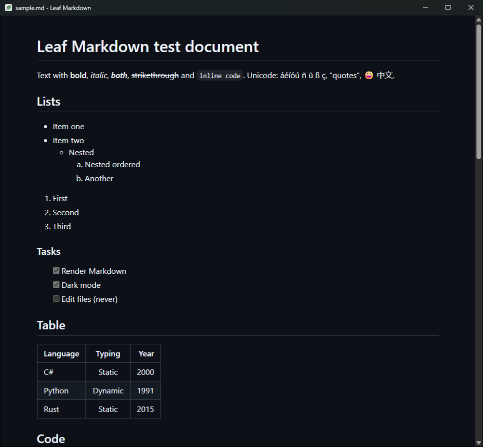

<p align="center"></p>

# 🍃 Leaf Markdown — Simple Markdown Reader
[](https://opensource.org/licenses/MIT)

A minimal Markdown viewer for Windows 10/11, built with C# and WebView2.  
It opens `.md` files and shows them beautifully rendered, like a PDF reader but for Markdown. No editing, no sidebars, no tabs.

<p align="center"></p>

---

## 🚀 Features

- GitHub-style rendering: tables, task lists, footnotes, alerts (`> [!NOTE]`), images and syntax-highlighted code
- Opens almost instantly and uses little memory
- Follows the Windows light or dark theme, title bar included
- Live reload: when the file is saved by another program the view updates and keeps your reading position
- Open files by double-click, drag & drop, `Ctrl+O` or the command line (`LeafMarkdown.exe "file.md"`)
- Zoom with `Ctrl` + mouse wheel (`Ctrl+0` resets it) and find in the document with `Ctrl+F`
- External links open in your default browser; links to other `.md` files open in the same window
- Safe with untrusted files: embedded HTML is sanitized, scripts never run, and only local images are loaded
- Powered by [Markdig](https://github.com/xoofx/markdig), [highlight.js](https://highlightjs.org) and [github-markdown-css](https://github.com/sindresorhus/github-markdown-css) (see [third-party notices](THIRD-PARTY-NOTICES.md))

---

## 📦 Install

Download `LeafMarkdown-Setup-x.y.z.exe` from [Releases](https://github.com/VitomDev/Leaf-Markdown/releases/latest) and run it.

> 🧰 **Recommended:** install it with [Vitool Box](https://github.com/VitomDev/Vitool-Box), which keeps all VitomDev apps in one place and installs or removes them with a switch.

- Per-user install, no admin rights needed
- Adds Leaf Markdown to the Start menu and opens `.md` files with it
- Needs the [.NET 10 Desktop Runtime](https://dotnet.microsoft.com/download/dotnet/10.0) (x64); the installer warns you if it's missing

Prefer a portable version? Download `LeafMarkdown.exe` and, to associate it with `.md` files, run `LeafMarkdown.exe --register` once (`--unregister` undoes it).

---

## 🔧 Build

Requirements: .NET 10 SDK and Inno Setup 6 (`winget install JRSoftware.InnoSetup`).

```powershell
.\build.cmd
```

It publishes the app to `dist/` and writes the installer to `installer/Output/`.

---

## 📚 Dependencies

- [Markdig](https://github.com/xoofx/markdig) — Markdown parsing
- [Microsoft WebView2 SDK](https://www.nuget.org/packages/Microsoft.Web.WebView2) — rendering, through the WebView2 Runtime built into Windows
- [highlight.js](https://github.com/highlightjs/highlight.js) — code syntax highlighting
- [github-markdown-css](https://github.com/sindresorhus/github-markdown-css) — GitHub-style look

See [third-party notices](THIRD-PARTY-NOTICES.md) for licenses.

---

## 🪟 Compatibility

Windows 10 and Windows 11, 64-bit.

---

## 🧪 Project Status

✅ Stable.  
This project is fully functional as-is and ready to use.
Future updates to improve features or the interface are not ruled out.

---

## 📄 License

[MIT](LICENSE) © VitomDev

---

## 📲 Contact

Feel free to reach out or follow me:

- 🐙 GitHub: [@VitomDev](https://github.com/VitomDev)
- 🐦 Twitter/X: [@VitomDev](https://twitter.com/VitomDev)
- 🎮 Twitch: [@VitomDev](https://www.twitch.tv/VitomDev)
- 💼 LinkedIn: [VitomDev](https://www.linkedin.com/in/víctor-escós-batalla/)
